<div align="center">

# OpsPilot

### AI-Powered Application Support & Incident Intelligence

**Correlates support tickets, application logs, metrics and internal documentation to generate evidence-backed
incident investigations.**

[](https://github.com/kgiannopoulou/opspilot/actions/workflows/ci.yml)
[](https://github.com/kgiannopoulou/opspilot/actions/workflows/security.yml)


[Architecture](#architecture) · [Demo](#demo) · [Engineering decisions](#engineering-decisions) ·
[AI evaluation](#rag--ai-evaluation) · [Tests](#testing) · [Security](#security) · [Run it](#running-locally)

</div>

## Why OpsPilot?

When customers report *"payment fails after pressing Confirm Order"*, an application support engineer walks the same
path every time: ticket → logs → metrics → database → runbooks → past incidents → root cause. During an outage that
walk takes the most time and is the easiest to get wrong.

OpsPilot automates the evidence-gathering and puts the result on one screen: a probable root cause, a confidence score,
the evidence for *and against* it, the relevant runbook passage, a safe diagnostic query and next steps. It is not a
chatbot. It behaves like a colleague who has already read the logs, and every conclusion it draws can be clicked
through to the data.

Built for a fictional SaaS company, **ShopStream**, whose five services are simulated with realistic logs, metrics and
injectable incidents → [problem statement, personas, success metrics](docs/problem-statement.md)

## Demo

The 90-second walkthrough is recorded in the next step.

**Live demo:** there is no public instance: the stack includes a SQL sandbox and, optionally, an LLM API key, which
should not sit on the open internet. `docker compose up` starts the complete system with demo data in about three
minutes ([Running locally](#running-locally)).

## Key features

| | |
|---|---|
| ✓ **Incident management** | Declare, investigate, identify, monitor, resolve; linked customer tickets; telemetry with the onset marked → [guide](docs/features.md#incident-investigation) |
| ✓ **Ticket workflow** | State machine, assignment, comments, timeline, idempotent creation and duplicate detection → [guide](docs/features.md#ticket-management) |
| ✓ **AI classification** | Category / priority / service suggestions that a human accepts, modifies or rejects → [guide](docs/features.md#ai-ticket-triage-human-in-the-loop) |
| ✓ **Log correlation** | WARN/ERROR patterns ±15 min around a ticket, against a 2-hour baseline, across dependencies → [guide](docs/features.md#automatic-log-correlation) |
| ✓ **Metrics correlation** | Latency, error rate, DB connections and CPU against each service's own baseline |
| ✓ **RAG knowledge retrieval** | Heading-aligned chunks in pgvector, hybrid scoring, cited by section → [guide](docs/features.md#retrieval-augmented-generation-rag) |
| ✓ **Evidence-backed root cause** | Hypotheses scored only from evidence; a grounding check rejects uncited claims → [guide](docs/features.md#evidence-citations--grounding) |
| ✓ **SQL investigation assistant** | Generated diagnostic queries, AST-validated and run read-only by a human → [guide](docs/features.md#investigation-queries-ai-generated-sql-safely) |
| ✓ **RBAC** | Four roles, permissions checked on every route and proven by a route × role test matrix → [guide](docs/features.md#authentication--access-control) |
| ✓ **Audit trail** | Every human and AI action, hash-chained, and the database refuses any edit → [guide](docs/features.md#audit-trail) |
| ✓ **Prompt-injection defence** | Malicious documents quarantined; retrieved text isolated as data → [security](docs/security.md#prompt-injection) |
| ✓ **Live progress** | Background workers + Server-Sent Events; degraded mode when the LLM or Redis is down → [guide](docs/features.md#background-workers-redis-streams) |

## Architecture


A Next.js analyst UI talks to a FastAPI backend through a same-origin proxy. PostgreSQL (with pgvector) is the system
of record for tickets, incidents, logs, metrics, embeddings and the audit trail. Redis carries the job queue, cache,
rate limits and live-update notifications. Background workers run triage and investigations; the LLM is optional and
sits behind a circuit breaker.
→ [Components, layering and flows](docs/architecture/README.md) · [database design](docs/architecture/database.md)

## AI investigation pipeline

```mermaid
flowchart LR
    T[Ticket / incident] --> C[Correlate logs & metrics<br/>±15 min, vs 2 h baseline]
    C --> E[Evidence collectors<br/>logs · metrics · dependencies<br/>changes · past incidents]
    E --> H[Score hypotheses<br/>confidence from evidence only]
    H --> R[Retrieve runbooks<br/>pgvector HNSW + hybrid boosts]
    R --> W[Write cited summary<br/>Claude via JSON schema<br/>or extractive fallback]
    W --> G{Grounding +<br/>injection checks}
    G -- pass --> Q[Propose read-only SQL<br/>AST allowlist]
    G -- fail --> X[Extractive write-up<br/>rejection recorded]
    X --> Q
    Q --> U[Engineer reviews<br/>accepts root cause · runs query · rates it]
    U --> A[(Audit trail)]
```



The evidence engine is deterministic and LLM-free (~25 ms). The model only explains evidence that is already stored,
cannot introduce facts the grounding check would not find, and never decides the confidence
([ADR 006](docs/decisions/006-evidence-first-investigations.md)).

## Technology stack

| Layer | Technology |
|---|---|
| **Frontend** | Next.js 16 (App Router), React 19, TypeScript, Tailwind CSS 4, hand-rolled SVG charts, Server-Sent Events client |
| **Backend** | Python 3.12, FastAPI, Pydantic 2, SQLAlchemy 2 (typed, mypy-checked), Alembic |
| **Data** | PostgreSQL 16 + pgvector (HNSW), Redis 7 (Streams, pub/sub, rate limits, cache) |
| **AI** | Claude (`claude-opus-5-5`, JSON-schema structured output) — optional; deterministic hashing embeddings or `bge-small-en-v1.5` (fastembed); sqlglot for SQL validation |
| **Infrastructure** | Docker Compose (non-root, read-only, capability-free containers), GitHub Actions, Prometheus + Grafana, Trivy, CodeQL, gitleaks, Dependabot |
| **Testing** | pytest (unit + integration against real PostgreSQL/Redis), Vitest + Testing Library, Playwright E2E |

## Example investigation

The seeded payment incident, as OpsPilot handles it. Every number below is from the demo data.

```text
TICKET     TCK-2026-00313  "Payment screen throws timeout after login"   P2 · customer support
           Customers on mobile log in fine, then the payment screen spins and fails with a timeout.

TRIAGE     PAYMENTS · P1 · payment-service   (keywords-v1 — awaiting human review)
CORRELATE  payment-service   ! anomalous  12 × GatewayTimeoutException (new)   p95 1,067 ms → 5,321 ms
           postgres-primary  ✓ normal
           order-service     ! anomalous  12 × Payment failed
           → Matches active incident INC-135 — Payment checkout timeout            [Link ticket]

INCIDENT   INC-135  Payment checkout timeout  SEV1 · Critical
ROOT CAUSE Payment gateway requests from payment-service are exceeding the configured 5000ms client timeout
           (provider=stripe); checkouts fail when the gateway call times out.            82 % · high confidence
EVIDENCE   ✓ 35 GatewayTimeoutException events since onset (none in the preceding 2 h)      [LOG-5812]
           ✓ payment-service p95 latency +407 % (1,049 ms → 5,321 ms)       [METRIC-payment-service-latency]
           ✓ error rate 0.4 % → 17.0 %                                   [METRIC-payment-service-error-rate]
           ✓ similar to INC-106 (41 days ago): stripe regional degradation                         [INC-106]
           ✓ postgres-primary healthy: query p95 14 ms (baseline 13 ms)    [METRIC-postgres-primary-health]
           · no deployments, config changes or scheduled jobs in the 30 min before onset       [CHANGE-none]
RUNBOOK    Payment Gateway Timeout Runbook §0 · Payment Service Architecture §2 · Checkout Incident Guide §1
QUERY      🔒 READ ONLY  Payment outcomes during the incident
           SELECT status, COUNT(*) …  →  CAPTURED 68 (avg 905 ms) · TIMEOUT 34 (avg 5000 ms)
NEXT       1. Check the stripe status page and #payments-alerts for a provider-side degradation
           2. Inspect PAYMENT_GATEWAY_TIMEOUT_MS (currently 5000ms)
           3. Query affected transactions to size the customer impact
CHECKS     ✓ Grounding check passed · 7 citations verified
```

## RAG & AI evaluation

A demo that looks right on three seeded incidents proves little. The [offline benchmark](docs/evaluation/README.md)
has known answers, runs in CI as a regression gate, and its report is generated from the run — nothing is typed by
hand:

| Suite | Set | Metric | Result |
|---|---|---|---:|
| Triage | 50 hand-labelled tickets (clear, vague, misleading) | Category / priority / service accuracy | 82 % / 68 % / 80 % |
| Retrieval | 40 queries → documents an expert would open | Recall@1 / Recall@3 / MRR | 92 % / 100 % / 0.96 |
| Investigations | 41 simulated incidents with injected faults (and 4 with none) | Correct root cause (top-1) | 95 % |
| | 37 fault cases | Runbook for the injected fault in the top 3 | 95 % |
| | 4 no-fault cases | "No known failure mode" at ≤ 35 % confidence | 100 % |
| | 253 citations | Resolve to evidence of the same run | 100 % |
| Prompt injection | 30 attacks + 25 benign look-alikes + 12 real documents | Attacks quarantined / benign wrongly quarantined | 87 % / 0 % |

Ground truth comes from the simulator: the expected root cause is the fault that was *injected*. The first run found
real bugs (runbook recall was 62 %), and both runs are in the [history](docs/evaluation/history.json). Weak spots are
reported, not hidden: priority on vague tickets is the lowest triage score, which is why a human reviews every
suggestion.

## Security

Built as if it will be attacked; every control is implemented and tested. Full write-ups:
[security controls](docs/security.md) · [threat model](docs/threat-model.md).

| Threat | Mitigation |
|---|---|
| SQL injection | ORM / bound parameters everywhere; Bandit + CodeQL |
| Prompt injection | Retrieved-context isolation (`<untrusted_*>` blocks, forged delimiters defanged), schema-constrained output, injection check on drafts |
| Malicious knowledge document | Ingestion validation → quarantine (never indexed) → admin review, audited |
| Privilege escalation | RBAC on every route, proven by a route × role matrix test; nothing reads authorization from model output |
| Credential theft | 15-minute JWTs in memory; rotating `HttpOnly` refresh tokens with reuse detection; strict CSP |
| Brute-force login / credential stuffing | Per-account lockout + per-client rate limit across accounts; bcrypt |
| Sensitive log exposure | Redaction filter for tokens, keys, passwords and e-mails; `422`s never echo secrets |
| LLM SQL generation | Read-only sandbox: AST allowlist → human click → read-only transaction as a least-privilege role |
| Vulnerable dependencies / images | pip-audit, npm audit, Trivy image + config scans, Dependabot, SHA-pinned Actions |

## Testing

| Layer | What | Count |
|---|---|---:|
| Backend unit | Scoring, chunking, embeddings, SQL validator, grounding, injection scanner, redaction, client IPs | 98 |
| Backend integration | Real PostgreSQL + Redis built from the migrations: API, services, constraints, triggers, workers, SSE | 201 |
| RBAC matrix | Every route × every role, derived from the app — a new endpoint without a check fails the build | ⤷ |
| AI benchmark gate | Triage, retrieval, investigation and prompt-injection suites must not regress | ⤷ |
| Frontend | Vitest + Testing Library: API client, SSE parser, components | 16 |
| End-to-end | Playwright against `docker compose`: declare → investigate in the worker → rate → resolve → audit; viewer is read-only | 2 |

**299 backend tests, 94 % line coverage** (CI fails under 90 %). The
[pipeline](.github/workflows/ci.yml) runs lint → type check → unit → integration → security scan → Docker build → E2E,
each stage gated on the ones before; a [security workflow](.github/workflows/security.yml) adds CodeQL, Trivy and
gitleaks, also weekly. → [Test strategy and failure testing](docs/features.md#testing)

## Running locally

```bash
git clone https://github.com/kgiannopoulou/opspilot.git
cd opspilot
docker compose up          # builds, migrates, seeds 60 days of demo history (~3 min the first time)
```

| What | Where |
|---|---|
| Analyst UI | http://localhost:3010 — `maria@opspilot.dev` / `opspilot-demo` (engineer) · `nikos@opspilot.dev` (admin) · `viewer@opspilot.dev` (read-only) |
| API docs (Swagger) | http://localhost:8010/docs |
| Health · readiness · metrics | `/health` · `/ready` · `/metrics` |
| Prometheus · Grafana | `docker compose --profile observability up` → http://localhost:9095 · http://localhost:3011 |

Everything works without API keys: deterministic embeddings and an extractive writer. Set
`OPSPILOT_LLM_PROVIDER=anthropic` and `ANTHROPIC_API_KEY` in `.env` for Claude-written summaries, triage and query
proposals ([`.env.example`](.env.example)). Development without Docker: [CONTRIBUTING.md](CONTRIBUTING.md).

## API

Interactive OpenAPI documentation at **http://localhost:8010/docs** (generated from the FastAPI schemas). The main
resources:

| Resource | Endpoints |
|---|---|
| Auth | `POST /auth/login` · `POST /auth/refresh` (rotating cookie) · `POST /auth/logout` · `GET /auth/me` |
| Tickets | `GET/POST /tickets` · `GET/PATCH /tickets/{n}` · `/transition` · `/assign` · `/comments` · `/correlation` · `/classification` |
| Incidents | `GET/POST /incidents` · `GET /incidents/{n}` · `/status` · `/tickets` · `/telemetry` · `/logs` · `/activity` |
| Investigations | `POST /incidents/{n}/investigations` (202) · `GET …/{id}` · `GET …/{id}/events` (SSE) · `…/queries/{q}/run` · `…/feedback` |
| Knowledge | `GET /knowledge` · `GET /knowledge/search` · `POST /knowledge` (validated upload) · `GET /knowledge/quarantine` · `POST /knowledge/{slug}/review` |
| Operations | `GET /dashboard/summary` · `GET /jobs` · `GET /ai/status` · `GET /ai/quality` · `GET /audit` · `GET /audit/verify` |

All under `/api/v1`, all authenticated except sign-in, all rate-limited.

## Engineering decisions

Architecture Decision Records: context, decision, alternatives and consequences.

| ADR | Decision |
|---|---|
| [001](docs/decisions/001-use-postgresql.md) | PostgreSQL as the single system of record |
| [002](docs/decisions/002-use-pgvector.md) | pgvector for semantic search instead of a separate vector database |
| [003](docs/decisions/003-use-redis-workers.md) | Redis Streams background workers, PostgreSQL as the job source of truth |
| [004](docs/decisions/004-use-sse-over-websockets.md) | Server-Sent Events, not WebSockets, for live progress |
| [005](docs/decisions/005-rag-retrieval-strategy.md) | RAG retrieval: heading-aligned chunks, hybrid scoring, evidence first |
| [006](docs/decisions/006-evidence-first-investigations.md) | Evidence-first investigations: the model explains, the evidence decides |
| [007](docs/decisions/007-ai-generated-sql-safety.md) | AI-generated SQL in a read-only, least-privilege sandbox |
| [010](docs/decisions/010-prompt-injection-defense.md) | Layered prompt-injection defence |

[All decisions](docs/decisions/README.md)

## Limitations

- **Simulated data.** ShopStream's logs and metrics come from a simulator. The collectors sit behind a repository
  interface, but there is no Loki / Prometheus / Datadog connector yet.
- **Three failure modes.** The hypothesis library knows gateway timeouts, DB pool exhaustion and SMTP failures;
  anything else gets an honest low-confidence *unknown* with its strongest signal, not a diagnosis.
- **The benchmark runs without an LLM by default.** The extractive writer passes the grounding check by construction;
  the LLM writer's rejection rate needs a run with an API key.
- **Heuristic injection screening.** Paraphrased and non-English instructions get past the scanner (13 % of the
  red-team set); the other layers are designed for that, but it is not a solved problem.
- **Single-node scope.** Fixed-window rate limits, a thread per open SSE stream, no HA for PostgreSQL or Redis, TLS
  terminated outside the stack, local accounts without MFA/SSO.

## Future work

- Connectors for real telemetry (Loki, Prometheus, OpenTelemetry traces) and ticketing systems (Jira, ServiceNow).
- Learned hypothesis ranking from analyst feedback, and new failure modes proposed from *unknown* investigations.
- An LLM-based injection classifier as an extra ingestion layer; nonce-based CSP; OIDC single sign-on.
- Post-incident review drafts from the timeline and audit trail.
- Cloud deployment (Terraform) with managed PostgreSQL and a public read-only demo.

<details>
<summary><b>Repository structure</b></summary>

```
opspilot/
├── frontend/            Next.js analyst UI (app/, components/, hooks/, services/, tests/{unit,components,e2e,media})
├── backend/
│   ├── app/
│   │   ├── api/         FastAPI routers
│   │   ├── auth/        JWT, RBAC, rate limits
│   │   ├── ai/          evidence engine, retrieval, LLM writer, grounding, SQL guard, injection defence
│   │   ├── services/    business rules, one transaction per use case
│   │   ├── workers/     Redis Streams queue and job handlers
│   │   ├── eval/        offline AI benchmark and report generator
│   │   └── core/        config, database, security, HTTP hardening, redaction, observability
│   ├── migrations/      Alembic
│   └── tests/
├── simulator/           ShopStream services, log/metric generators, incident scenarios
├── knowledge-base/      runbooks, troubleshooting guides, architecture notes, process
├── infrastructure/      Dockerfiles, Prometheus, alert rules, Grafana
├── docs/                architecture, decisions, evaluation, security, threat model, features, media
└── .github/             CI and security workflows, Dependabot
```

</details>

## License

[MIT](LICENSE)
