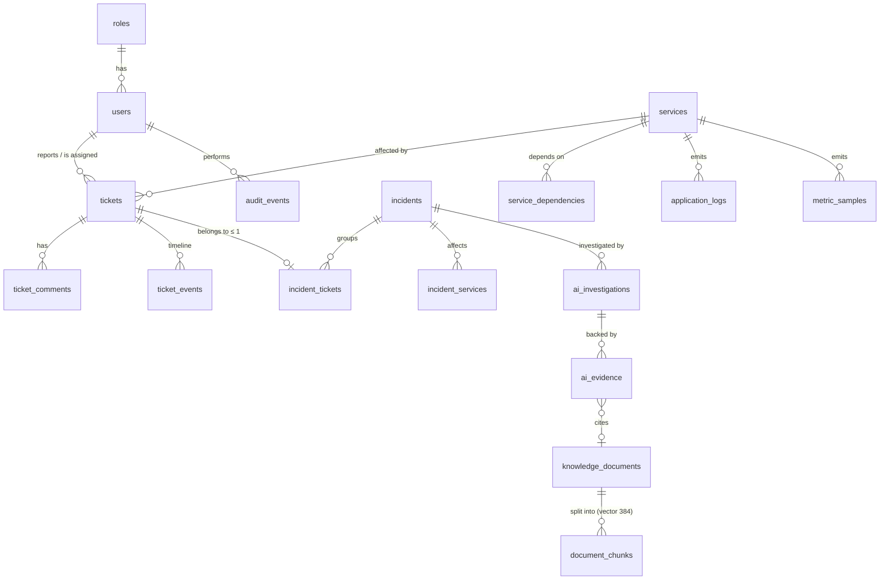
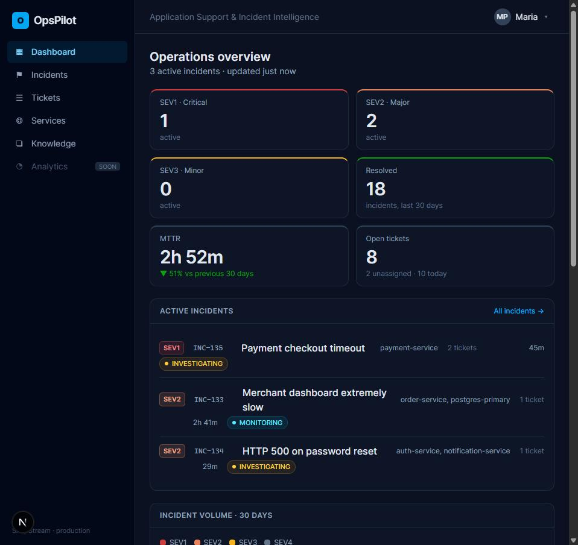
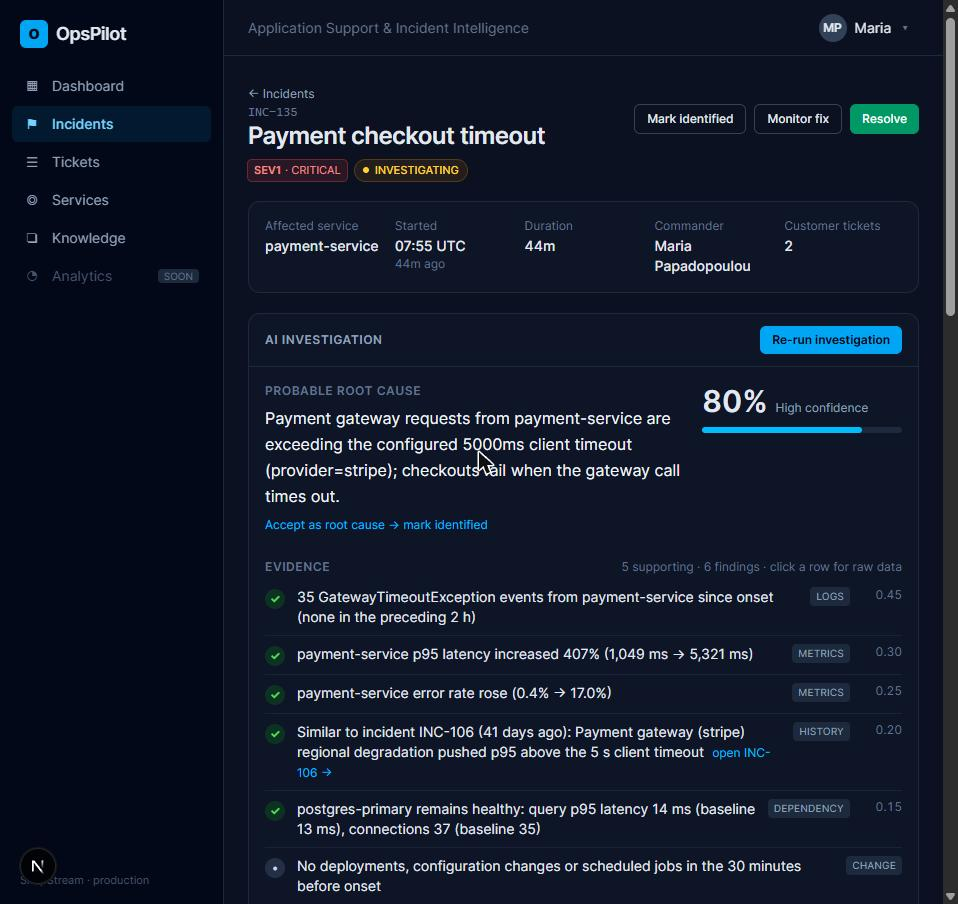
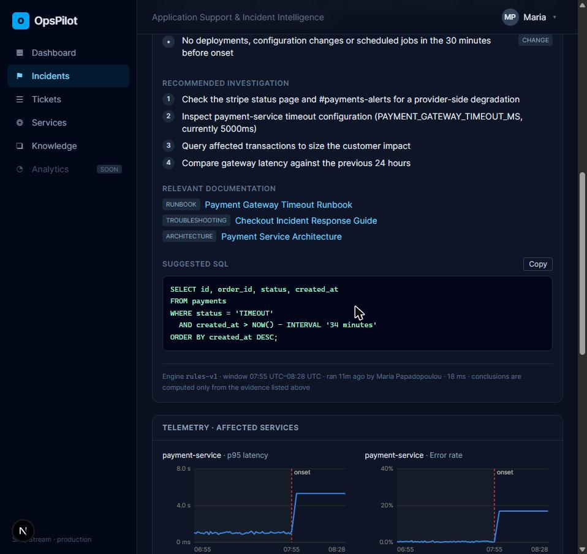
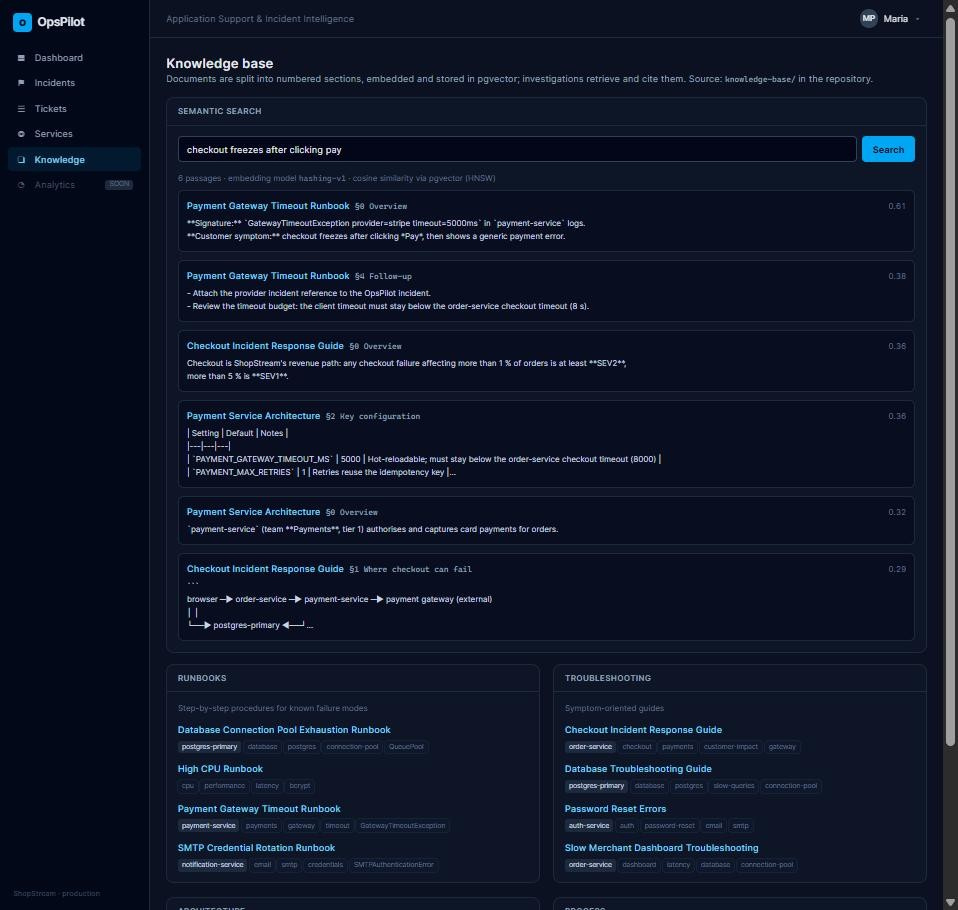
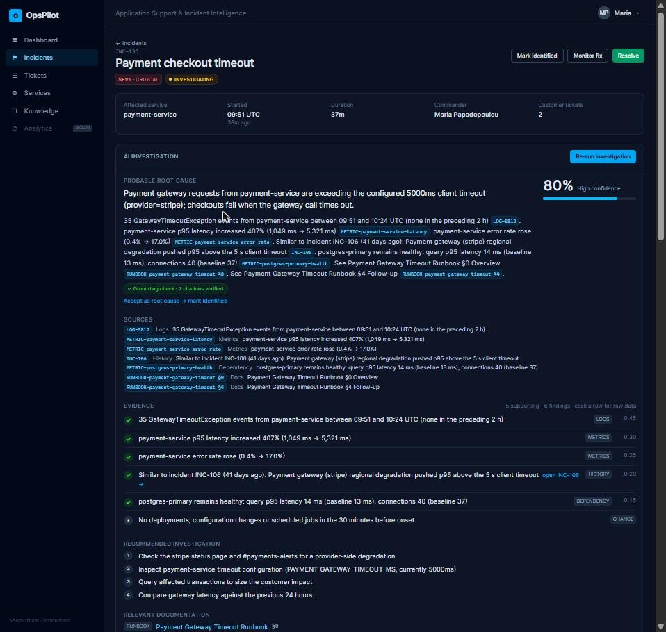
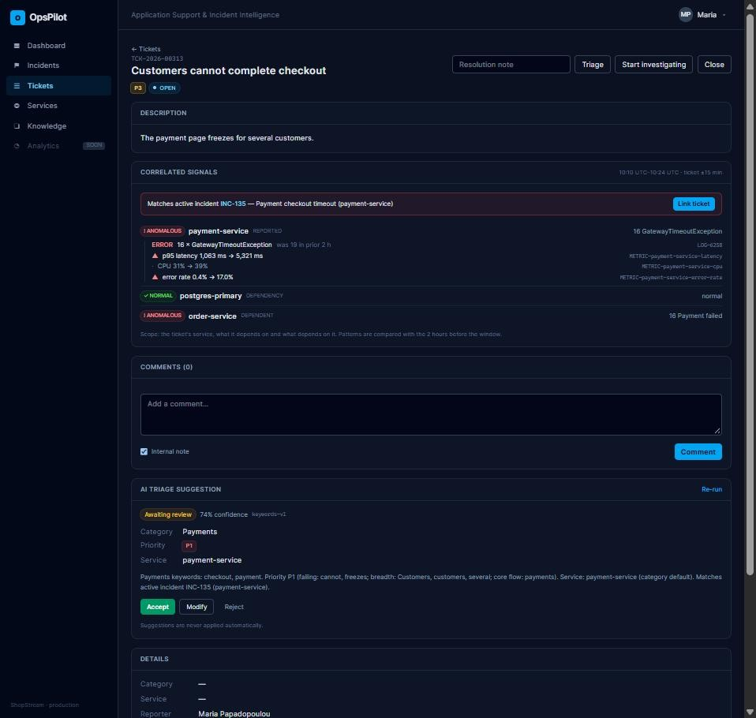
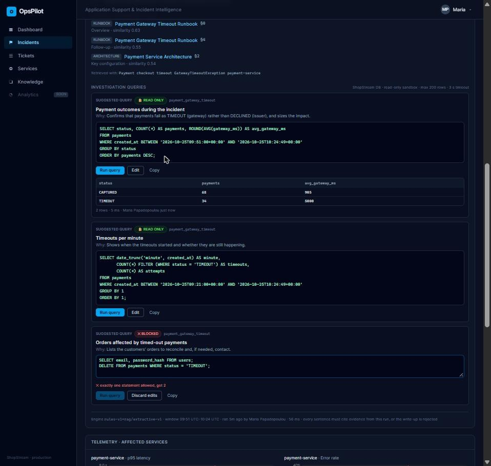
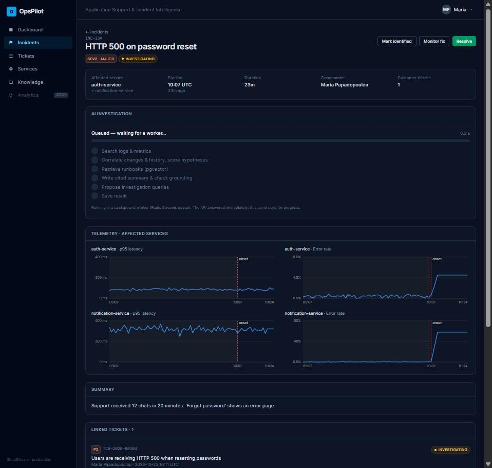
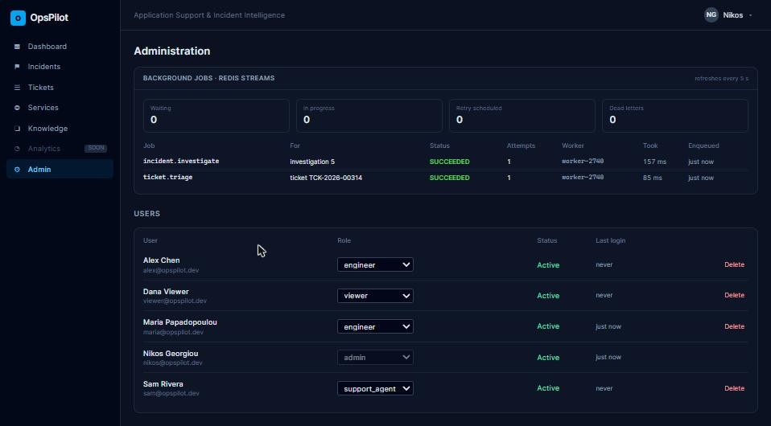

<div align="center">

# OpsPilot

### AI-Powered Application Support & Incident Intelligence

**Tickets → Logs → Metrics → AI Investigation → Resolution**

[Architecture](docs/architecture/README.md) · [Problem Statement](docs/problem-statement.md) · [API Docs](#api) · [Roadmap](#roadmap)

`FastAPI` · `Next.js` · `PostgreSQL` · `Redis` · `pgvector` · `Docker` · `GitHub Actions`

</div>

---

OpsPilot is an application support platform that correlates **support tickets**, **application logs** and
**service metrics** to help support engineers investigate incidents. Instead of a chatbot, it behaves like a
colleague who has already read the logs: every conclusion it draws is backed by evidence you can click through.

> **Status:** active development — built in public, step by step (19 steps so far, see the [roadmap](#roadmap)).

## The problem

ShopStream, a fictional SaaS company, runs an e-commerce and payment platform. Customers report symptoms —
*"payment fails after pressing Confirm Order"*, *"the dashboard takes 30 seconds to load"*, *"HTTP 500 on password
reset"* — and an Application Support Engineer has to walk from the ticket to logs, database, metrics, runbooks
and past incidents before a root cause emerges.

OpsPilot automates that evidence-gathering path and puts the result on one screen: a probable root cause,
a confidence score, the evidence behind it, next investigation steps and the relevant documentation.

→ Full write-up: [docs/problem-statement.md](docs/problem-statement.md)

## Architecture


A Next.js analyst UI talks to a FastAPI backend. PostgreSQL is the system of record (tickets, incidents, logs,
metrics, audit) and will hold the `pgvector` knowledge base; Redis provides caching and rate limiting.
The investigation engine correlates logs, metrics and past incidents into an evidence-backed root-cause report.

→ Components, flows and design principles: [docs/architecture](docs/architecture/README.md) ·
decisions: [docs/decisions](docs/decisions)

## ShopStream simulator

OpsPilot needs real evidence to investigate, so the repository ships a deterministic simulator of the fictional
ShopStream platform — `auth-service`, `payment-service`, `order-service`, `notification-service` and
`postgres-primary` — that emits realistic logs and per-minute metrics and can inject incidents:

```
2026-10-22T14:31:42Z INFO  payment-service  Payment request initiated order_id=ORD-84931
2026-10-22T14:31:42Z INFO  payment-service  Calling payment gateway provider=stripe
2026-10-22T14:31:47Z ERROR payment-service  GatewayTimeoutException provider=stripe timeout=5000ms order_id=ORD-84931
2026-10-22T14:31:47Z WARN  order-service  Payment failed order_id=ORD-84931 retry=1
```

| Scenario | Symptom | Metric footprint |
|---|---|---|
| `payment_gateway_timeout` | Checkout freezes after clicking Pay | payment p95 latency ≈ 5.3 s (+412 %), error rate 17 %, DB normal |
| `db_pool_exhaustion` | Dashboard takes 30 s to load | DB connections 99/100, query p95 2.4 s, order-service p95 29 s |
| `smtp_auth_failure` | HTTP 500 on password reset | notification error rate 58 %, auth-service error rate 4.5 % |

→ [simulator/README.md](simulator/README.md)

## Ticket management

The platform is useful before any AI is involved. Tickets follow a support lifecycle enforced by a state machine
([`ticket_workflow.py`](backend/app/services/ticket_workflow.py)):

```
OPEN ──► TRIAGED ──► INVESTIGATING ──► RESOLVED ──► CLOSED
  │         ▲  │            ▲              │
  │         └──┘ (back)     └── reopen ────┘
  └──► CLOSED (duplicate / not a bug — resolution note required)
```

- Human-friendly numbers (`TCK-2026-00042`) from a Postgres sequence, priority P1–P4, affected service, labels.
- Assignment, public and internal comments, and an append-only **event timeline** (created, status changed,
  priority changed, assigned, commented) written in the same transaction as the change.
- Concurrent updates to one ticket are serialised with `SELECT … FOR UPDATE`.
- The API returns `allowed_transitions` with every ticket so the UI only offers valid actions.

| Method | Endpoint | Purpose |
|---|---|---|
| `GET` | `/api/v1/tickets?status=&priority=&service=&assignee_id=&unassigned=&q=&page=` | Filtered, paginated queue |
| `POST` | `/api/v1/tickets` | Create a ticket |
| `GET` / `PATCH` | `/api/v1/tickets/{number}` | Read / edit title, description, priority, service, labels |
| `POST` | `/api/v1/tickets/{number}/transition` | Move through the lifecycle |
| `POST` | `/api/v1/tickets/{number}/assign` | Assign / unassign |
| `GET` / `POST` | `/api/v1/tickets/{number}/comments` | Discussion |
| `GET` | `/api/v1/tickets/{number}/events` | Timeline |

Interactive OpenAPI docs: `http://localhost:8010/docs`.

## Database design

18 tables in PostgreSQL 16 + `pgvector`, managed by Alembic migrations:



- **Integrity in the schema, not only in code:** foreign keys with deliberate `ON DELETE` rules, unique constraints
  (one incident per ticket, one metric value per series/minute), `CHECK` constraints for every enumeration,
  `confidence BETWEEN 0 AND 1`, no self-dependencies.
- **Indexes for real queries:** composite queue index, partial index on WARN/ERROR logs, BRIN on log timestamps,
  GIN on document tags, HNSW (`vector_cosine_ops`) on chunk embeddings.
- **JSONB only where justified** — variable log attributes, event payloads, engine-owned evidence data.
- **Transactions + audit:** each use case commits the change, its timeline event and its `audit_events` row together.
- A test fails if ORM models and migrations drift (`alembic` autogenerate comparison).

→ Full design notes and the complete ER diagram: [docs/architecture/database.md](docs/architecture/database.md)

The demo seed (`python -m app.scripts.seed --reset`) loads 60 days of incident history, ~300 tickets, and the last
6 hours of simulated logs/metrics with three live incidents.

## Authentication & access control

| Endpoint | Behaviour |
|---|---|
| `POST /api/v1/auth/login` | bcrypt-verified credentials → 15-minute **JWT access token** (HS256, algorithm pinned, issuer checked) in the body + **refresh token** in an `HttpOnly`, `SameSite=Strict` cookie scoped to `/api/v1/auth` |
| `POST /api/v1/auth/refresh` | **Rotates** the refresh token on every use. Presenting an already-rotated token is treated as theft: the whole token family is revoked |
| `POST /api/v1/auth/logout` | Revokes the session's refresh-token family and clears the cookie |
| `GET /api/v1/auth/me` | Current user, role and effective permissions |

Refresh tokens are opaque random strings stored only as SHA-256 hashes. Failed logins are throttled per
e-mail + IP in Redis (5 failures → 15-minute lock), error messages never reveal whether an e-mail exists, and login
timing is equalised for unknown users. Users are re-loaded on every request, so deactivating an account takes effect
immediately rather than when its JWT expires. Logins, failures, token-reuse detection and all user management
are written to `audit_events`.

**Role-based access control** — roles live in the database, permissions per role in
[`app/auth/permissions.py`](backend/app/auth/permissions.py), enforced with a `require(Permission.X)` dependency:

| Permission | Viewer | Support Agent | Engineer | Admin |
|---|:-:|:-:|:-:|:-:|
| `tickets:read`, `incidents:read`, `dashboard:read` | ✅ | ✅ | ✅ | ✅ |
| `tickets:write` — create/update/comment/assign | | ✅ | ✅ | ✅ |
| `incidents:investigate` — run investigations, link tickets | | | ✅ | ✅ |
| `users:manage` — `POST/PATCH/DELETE /users` | | | | ✅ |
| `ai:feedback` — rate AI investigations | | ✅ | ✅ | ✅ |
| `services:manage`, `audit:read` | | | | ✅ |

`DELETE /api/v1/users/{id}` requires **admin**; it is a soft delete (history keeps its references) that also
revokes every refresh token. Admins cannot delete, deactivate or demote themselves.

Demo accounts (password `opspilot-demo`): `nikos@opspilot.dev` (admin), `maria@opspilot.dev` and
`alex@opspilot.dev` (engineer), `sam@opspilot.dev` (support agent), `viewer@opspilot.dev` (viewer).

## Analyst dashboard

A Next.js analyst UI in the spirit of Datadog / ServiceNow / PagerDuty: sign-in, a sidebar app shell that hides what
your role cannot use, and five working screens — **Dashboard**, **Incidents**, **Tickets** (queue + detail with
lifecycle actions, assignment, comments and timeline), **Services** and **Admin** (user management).



The main dashboard answers "what is on fire right now?" at a glance:

- **Active incidents by severity** (SEV1–SEV3), **resolved** count and **MTTR** for the last 30 days with the change
  against the previous 30 days, open / unassigned / today's ticket counts.
- **Active incident list** ordered by severity then age, with affected services, linked tickets and duration.
- **Incident volume** (stacked by severity) and **ticket volume** for the last 30 days — hand-rolled SVG charts with
  hover tooltips, no chart library.
- **Service health** for the last 6 hours: status derived from error rate and p95 latency against the service's own
  median baseline, an error-rate sparkline and the latency change in percent.

| Method | Endpoint | Purpose |
|---|---|---|
| `GET` | `/api/v1/dashboard/summary` | Everything the dashboard renders in one round trip — aggregated in SQL (`FILTER`, `date_bin`, `percentile_cont`) and cached in Redis for 15 s because every open dashboard polls it |
| `GET` | `/api/v1/incidents?state=active\|resolved\|all&severity=&page=` | Incident list, active first |

The cache fails open: if Redis is unavailable the summary is computed directly. The access token is kept in memory
only (never `localStorage`); a page reload restores the session through the `HttpOnly` refresh cookie, and the
Next.js server proxies `/api/*` so that cookie stays first-party.

## Incident investigation

The incident page is the showcase screen: everything an engineer needs to go from *"customers can't pay"* to a
probable root cause, without opening five tools.





**How the investigation engine works** ([`app/ai/engine.py`](backend/app/ai/engine.py), engine `rules-v1`):

1. **Scope:** the affected services plus their direct dependencies, over a window starting at onset (capped at 60
   minutes so a long-running incident is not polluted by later, unrelated ones). "Normal" is the 2 hours before onset.
2. **Evidence collectors** query what is stored in PostgreSQL:
   - *Logs:* WARN/ERROR lines grouped by service + message, compared with the baseline rate (new vs. pre-existing).
   - *Metrics:* p90 during the incident vs. median baseline for latency, error rate, DB connections, query latency, CPU.
   - *Dependency health:* a healthy dependency localises the fault (*"postgres-primary remains healthy"*); a sick one
     **contradicts** the hypothesis and lowers confidence.
   - *Change events:* config reloads, scheduled jobs and deployments in the 30 minutes before onset.
   - *History:* resolved incidents with a matching error signature (*"Similar to INC-106, 41 days ago"*).
   - *Knowledge base:* runbook passages found by semantic search (see [RAG](#retrieval-augmented-generation-rag)).
3. **Hypotheses** ([`hypotheses.py`](backend/app/ai/hypotheses.py)) are proposed by log signatures and scored *only*
   from the evidence: `confidence = (1 − Π(1 − w) over supporting) × Π(1 − w) over contradicting`, capped at 97 %.
   The best-supported one wins. Root-cause text, steps and SQL are templates filled from real log attributes
   (`provider=stripe`, `timeout=5000ms`), so they never state a value that is not in the data.
4. Nothing matches? The result is an honest low-confidence *unknown* (≤ 35 %) naming the strongest new signal.

Every run is stored as an immutable `ai_investigations` row with its ordered `ai_evidence` (stance, weight and the raw
numbers in JSONB), audited, and shown in the UI with one click to see the data behind each claim. Results on the
seeded scenarios:

| Incident | Diagnosis | Confidence | Key evidence |
|---|---|---|---|
| Payment checkout timeout | Gateway exceeds the 5 s client timeout | ~80 % | 35 × `GatewayTimeoutException`, p95 +407 %, DB healthy, similar INC |
| Merchant dashboard slow | DB connection pool exhaustion | ~94 % | `QueuePool limit`, DB connections 33 → 99, revenue-report job started 2 min before |
| HTTP 500 on password reset | SMTP authentication failure | ~68 % | `SMTPAuthenticationError` (535), SMTP credentials reloaded 1 min before onset |

The rest of the page: incident lifecycle actions (`INVESTIGATING → IDENTIFIED → MONITORING → RESOLVED`, resolving
requires a root cause, *Accept as root cause* copies the AI finding), per-minute telemetry charts with the onset
marked, linked customer tickets and a live tail of errors/warnings. The knowledge base (`knowledge-base/*.md`) is
loaded idempotently by content hash and browsable at `/knowledge`.

| Method | Endpoint | Purpose |
|---|---|---|
| `GET` | `/api/v1/incidents/{number}` | Incident with linked tickets, allowed transitions and the latest investigation |
| `POST` | `/api/v1/incidents/{number}/investigations` | Run the engine (`incidents:investigate` — engineers, admins) |
| `GET` | `/api/v1/incidents/{number}/investigations` | Investigation history |
| `POST` | `/api/v1/incidents/{number}/status` | Lifecycle transition (+ root cause) |
| `GET` | `/api/v1/incidents/{number}/telemetry` | Metric series of affected services, 1 h before onset → now |
| `GET` | `/api/v1/incidents/{number}/logs?limit=` | Recent WARN/ERROR lines since onset |
| `GET` | `/api/v1/knowledge`, `/api/v1/knowledge/{slug}` | Knowledge base |

The evidence engine itself is deliberately LLM-free: deterministic, testable and fast (~20 ms). Language models only
enter at the write-up stage, below, and may only explain evidence that is already stored (ADR 0004).

## Retrieval-augmented generation (RAG)

```
Incident ─► search query ─► embedding ─► pgvector HNSW (cosine) ─► re-rank ─► runbook passages ─┐
Logs · metrics · changes · history ─► evidence engine (scored hypothesis) ───────────────────────┴─► writer ─► investigation
```

- **Knowledge base** — 12 fictional ShopStream documents in [`knowledge-base/`](knowledge-base/): runbooks (payment
  gateway timeout, DB connection pool, SMTP rotation, high CPU), troubleshooting guides (checkout, password reset,
  slow dashboard, database), architecture notes (payment and authentication services) and the incident response
  process.
- **Chunking** ([`chunking.py`](backend/app/ai/chunking.py)) — split on `##`/`###` headings so every chunk belongs to one
  numbered section (`§2`, `§2.1`) that can be cited; long sections are split on paragraphs. The embedded text is
  prefixed with *document › heading* so "1. Check the status page" still means something on its own.
- **Embeddings** ([`embeddings.py`](backend/app/ai/embeddings.py)) — pluggable. The default `hashing-v1` is a
  deterministic, dependency-free feature-hashed embedding (camelCase splitting, stemming, an ops synonym table that
  maps *freezes → timeout*, *slow → latency*) so CI and laptops need no model download. `fastembed`
  (BAAI/bge-small-en-v1.5, `pip install -r requirements-ml.txt`) has the same 384 dimensions — switching is a config
  change, and because each chunk records the model that embedded it, a switch re-embeds everything automatically.
- **Storage & search** — `document_chunks.embedding vector(384)` with an HNSW `vector_cosine_ops` index. Retrieval
  ([`retrieval.py`](backend/app/ai/retrieval.py)) is hybrid: cosine similarity plus small, explainable boosts for the
  affected service's documents and for curated tags matching the error signature; at most two passages per document.
- **Query generation** — built from the incident title, the matched log signature and corroborating messages, and
  stored on the investigation (`search_query`) so retrieval can be audited. For *unknown* failure modes the query
  uses the strongest new log signal, so a runbook can still help where no hypothesis exists.
- **Writer** ([`writer.py`](backend/app/ai/writer.py)) — with `OPSPILOT_LLM_PROVIDER=anthropic` Claude writes the root
  cause, a short narrative and the next steps from the evidence and passages, through a JSON-schema constrained call
  ([`llm.py`](backend/app/ai/llm.py)). Without a key — or when the call fails — an extractive writer composes the
  same sections from the evidence summaries, so the product never depends on an LLM being up.

| Method | Endpoint | Purpose |
|---|---|---|
| `GET` | `/api/v1/knowledge/search?q=&k=&service=` | Semantic search over passages (the retrieval investigations use) |



`python -m app.scripts.reindex` syncs `knowledge-base/` (the API container runs it on start); only changed documents
are re-chunked and re-embedded.

## Evidence citations & grounding



*"The payment gateway probably timed out"* is not useful during an outage. OpsPilot's write-ups cite every claim:

> 35 GatewayTimeoutException events from payment-service between 09:06 and 09:39 UTC (none in the preceding 2 h)
> **[LOG-5812]**. payment-service p95 latency increased 407% (1,049 ms → 5,321 ms) **[METRIC-payment-service-latency]**.
> Similar to incident INC-106 (41 days ago): payment gateway (stripe) regional degradation pushed p95 above the 5 s
> client timeout **[INC-106]**. postgres-primary remains healthy: query p95 latency 14 ms (baseline 13 ms)
> **[METRIC-postgres-primary-health]**. See Payment Gateway Timeout Runbook §0 **[RUNBOOK-payment-gateway-timeout §0]**.
>
> *Grounding check passed · 7 citations verified* — the seeded payment incident, extractive writer

- **Citation keys** are assigned by the evidence engine, never by the model: `LOG-<first log line id>`,
  `METRIC-<service>-<metric>`, `CHANGE-<log id>`, the incident number for history, and
  `RUNBOOK|GUIDE|ARCH|PROCESS-<slug> §<section>` for knowledge-base passages (the chunk is stored with the evidence).
- **Grounding check** ([`grounding.py`](backend/app/ai/grounding.py)) runs on every write-up before it is stored:
  1. every `[REF]` must exist in this investigation (an invented reference is the clearest hallucination signal);
  2. every narrative sentence must cite something;
  3. every number in a sentence must appear in the evidence *that sentence cites* — "5.3 s" fails when the evidence
     says 5,321 ms, because the reader could not find it where the citation points. Numbers in the root cause must
     exist somewhere in the evidence.
- An LLM draft that fails is **not shown**: the extractive write-up (which passes by construction) is used, and the
  rejected draft's report is stored in `ai_investigations.grounding`, so prompt or model changes can be evaluated by
  their rejection rate. The UI shows the check result, renders citations as chips that jump to the evidence row, and
  lists the cited sources.

## AI ticket triage (human in the loop)

When a ticket arrives — *"Customers cannot complete checkout. The payment page freezes."* — OpsPilot suggests how
to triage it:

```json
{ "category": "PAYMENTS", "priority": "P1", "service": "payment-service", "confidence": 0.74,
  "rationale": "Payments keywords: checkout, payment. Priority P1 (failing: cannot, freezes; breadth: Customers; core flow: payments)." }
```

The suggestion is stored as a **PENDING** `ticket_classifications` row and the ticket is **not changed**. An analyst
then chooses on the ticket page:

| Action | Effect |
|---|---|
| **Accept** | Category, priority and service are applied; timeline + audit record who accepted it |
| **Modify** | The analyst's values are applied; the prediction is kept next to them (`final_*` columns) |
| **Reject** | Nothing is applied |

- **Engines** ([`classifier.py`](backend/app/ai/classifier.py)): `keywords-v1` is transparent — category lexicons,
  impact phrases for priority (*failing* × *breadth* × *core flow*, mirroring the severity table in the incident
  process document), service from an explicit mention, the category, the product area or, as a last resort, the
  best-matching knowledge-base document. With an LLM configured, Claude answers through a JSON schema whose enums
  *are* the categories, priorities and service names from the catalogue, so it cannot invent a service; any failure
  falls back to the keyword engine.
- **Feedback loop** — because predictions are never overwritten, every reviewed row is a labelled example.
  `GET /api/v1/tickets/classifications/metrics` reports the acceptance rate and which fields analysts correct most:
  the number to watch before trusting a new model or prompt.
- Re-running the classifier supersedes a pending suggestion; a reviewed suggestion cannot be reviewed again (409).

| Method | Endpoint | Purpose |
|---|---|---|
| `GET` | `/api/v1/tickets/{number}/classification` | Latest suggestion and its review |
| `POST` | `/api/v1/tickets/{number}/classification` | Request a fresh suggestion (`tickets:write`) |
| `POST` | `/api/v1/tickets/{number}/classification/{id}/review` | `{"action": "accept" \| "modify" \| "reject", ...}` |
| `GET` | `/api/v1/tickets/classifications/metrics` | Acceptance rate and corrections per field |

## Automatic log correlation



A ticket says *"Payment screen times out after login"*. Before anyone opens a log viewer, OpsPilot looks at what the
platform was doing **±15 minutes around the ticket's creation**, for the reported service, the services it depends
on and the services that depend on it ([`correlation.py`](backend/app/ai/correlation.py)):

```
payment-service    reported    ! anomalous   19 × GatewayTimeoutException (new)   p95 latency 1,049 ms → 5,321 ms
postgres-primary   dependency  ✓ normal      query p95 14 ms (baseline 13 ms)
order-service      dependent   ! anomalous   19 × Payment failed (new)
→ Matches active incident INC-135 — Payment checkout timeout            [Link ticket]
```

- WARN/ERROR patterns are compared with the 2 hours before the window (a pattern is *new* at 5× its usual rate), and
  latency, error rate, connections and CPU with their baseline, using the same rules as the investigation engine.
  Every pattern keeps its `LOG-<id>` citation key.
- A ticket with no service is scoped by its AI suggestion's service, or the whole platform.
- **The AI receives the same signals:** the triage classifier gets the correlation, so a vague ticket
  (*"something is weird"*) is routed to the service with the most new errors, and the rationale names the active
  incident it matches. With an LLM, the signals are part of the prompt.
- An open incident covering an anomalous service is suggested; engineers link the ticket with one click
  (`POST /api/v1/incidents/{number}/tickets`).

| Method | Endpoint | Purpose |
|---|---|---|
| `GET` | `/api/v1/tickets/{number}/correlation` | Per-service log patterns and metric deltas around the ticket, suspected incident |
| `POST` | `/api/v1/incidents/{number}/tickets` | Link a ticket to an incident (`incidents:investigate`) |

## Investigation queries (AI-generated SQL, safely)

Each investigation proposes diagnostic queries against the ShopStream application database — never against
OpsPilot's own — with the reason to run them:

```
AI GENERATED QUERY                                   🔒 READ ONLY
Payment outcomes during the incident
Why: Confirms that payments fail as TIMEOUT (gateway) rather than DECLINED (issuer), and sizes the impact.

SELECT status, COUNT(*) AS payments, ROUND(AVG(gateway_ms)) AS avg_gateway_ms
FROM payments
WHERE created_at BETWEEN '2026-10-25T09:06:00+00:00' AND '2026-10-25T09:40:00+00:00'
GROUP BY status ORDER BY payments DESC;                                    [Run query] [Edit]
```

Queries come from the matched hypothesis (curated templates, filled with the investigation window so a re-run
returns the same rows) and, with an LLM configured, from the model, which receives the schema and the evidence. **No
proposal is executed automatically.** An engineer runs it, optionally after editing it, and the result table appears
in place. Defense in depth ([ADR 0006](docs/decisions/0006-ai-generated-sql-safety.md)):

| Layer | Where | What it stops |
|---|---|---|
| Permission + audit | API | Only `incidents:investigate`; every run (and every refusal) is an audit event with the SQL |
| AST validator | [`sql_guard.py`](backend/app/ai/sql_guard.py) (sqlglot) | Anything but one SELECT; INSERT/UPDATE/DELETE/DDL/COPY/SET anywhere in the tree; `SELECT … INTO`; `FOR UPDATE`; tables outside the allowlist (`payments`, `orders`, `password_reset_requests`, `pg_stat_activity`); functions outside the allowlist (`pg_sleep`, `pg_read_file`, `dblink`, `set_config`, …); adds/lowers `LIMIT 200` |
| Re-validation | [`services/queries.py`](backend/app/services/queries.py) | Stored verdicts and edited SQL are never trusted — validated again at run time |
| Read-only transaction | PostgreSQL | `SET TRANSACTION READ ONLY`: the database refuses writes even if the validator had a bug |
| Least privilege | PostgreSQL | `SET LOCAL ROLE opspilot_readonly`: can read the `shopstream` schema, gets *permission denied* on `users`, `tickets`, … |
| Resource limits | PostgreSQL | `statement_timeout` 3 s, `lock_timeout` 1 s, at most 200 rows fetched |
| No side effects | Connection | Separate connection, transaction always rolled back |

The tests include a "validator bypassed" fixture that disables the first layers and asserts the database layers still
refuse `DELETE`, `UPDATE` and reading password hashes, and cancel `pg_sleep`. LLM proposals that fail validation are
stored as **BLOCKED** with their violations and shown, not hidden — a useful signal when evaluating a model.



| Method | Endpoint | Purpose |
|---|---|---|
| `POST` | `/api/v1/incidents/{n}/investigations/{id}/queries/{qid}/run` | Run a proposal (body `{"sql": ...}` to run an edited version) |
| `POST` | `/api/v1/sql/validate` | Dry-run the safety checks, used for live feedback while editing |

## Background workers (Redis Streams)

An LLM call — or even a 100 ms evidence pipeline — should not hold an HTTP request open. Ticket triage and
investigations run in a worker:

```
POST /tickets ───────────► ticket saved ─► job row (PostgreSQL) ─► XADD opspilot:jobs ─► 201 in ~60 ms
POST /incidents/…/investigations ─► QUEUED run + job ───────────────────────────────► 202 in ~60 ms

worker (XREADGROUP)
 ├─ ticket.triage         correlate logs/metrics around the ticket → classify → PENDING suggestion
 └─ incident.investigate  search logs & metrics → score hypotheses → retrieve runbooks (pgvector)
                          → write cited summary + grounding check → propose queries → save
                          (each stage committed as it starts, so the UI shows live progress)
```

| Concern | How |
|---|---|
| Delivery | Redis Streams consumer group: each message to exactly one worker; `XACK` when done |
| Crashed worker | Messages idle > 60 s are taken over with `XAUTOCLAIM` |
| Failures | 3 attempts with exponential backoff (sorted-set delay queue), then the **dead-letter** stream |
| Idempotency | Jobs and investigations that already finished are skipped on redelivery |
| Source of truth | `background_jobs` in PostgreSQL (status, attempts, error, worker, timings); Redis only carries ids |
| Redis down | The API still answers: the job runs in-process after the response (FastAPI `BackgroundTasks`) |
| Concurrency | One active investigation per incident (409 otherwise); scale with `docker compose up --scale worker=3` |
| Shutdown | SIGTERM finishes the current job, then exits |

The incident page polls the queued run every second and shows each stage (`Search logs & metrics ✓ → Retrieve
runbooks … → Save result`); new tickets show *"AI triage running in the background…"* until the suggestion lands.
Admins see queue depth, retries, dead letters and per-job timings on `/admin` (`GET /api/v1/jobs`). Why a
hand-written queue instead of Celery/RQ: the semantics above fit in [`queue.py`](backend/app/workers/queue.py)
(~100 lines), there is nothing to configure, and RQ's forking worker does not run on Windows.

| Queued investigation (worker paused for the screenshot) | Admin: queue depth and recent jobs |
|---|---|
|  |  |

| Method | Endpoint | Purpose |
|---|---|---|
| `POST` | `/api/v1/incidents/{number}/investigations` | Queue an investigation → **202** with the QUEUED run |
| `GET` | `/api/v1/incidents/{number}/investigations/{id}` | Poll status and per-stage progress |
| `GET` | `/api/v1/jobs` | Queue depth, outcomes by status, recent jobs (admin) |

## Audit trail

Enterprise software has to answer *"who changed this, and when?"* — including what the AI did on its own. Every
important action writes an `audit_events` row in the same transaction as the change, and the incident page tells the
story of the incident and its customer tickets from those rows:

```
09:10:00  Ticket TCK-2026-00301 created by Sam Rivera
09:10:00  AI classification started for TCK-2026-00301                       auto
09:10:01  AI predicted PAYMENTS · P1 for TCK-2026-00301 (74% confidence)       auto
09:11:00  Sam Rivera assigned TCK-2026-00301 to Maria Papadopoulou
09:12:00  Maria Papadopoulou changed service on TCK-2026-00301 → payment-service
09:12:00  Incident INC-135 declared by Maria Papadopoulou (SEV1)
09:40:12  AI investigation started                                             auto
09:40:12  AI investigation generated: payment_gateway_timeout (80% confidence) auto
09:46:31  Maria Papadopoulou accepted the AI root cause from investigation #2
09:52:03  Incident resolved by Maria Papadopoulou
```

Covered: ticket lifecycle, assignment, edits (with old → new service), comments, AI triage started / predicted /
reviewed, incident declared / linked / status changes, investigations requested / started / generated / failed, the
analyst accepting an AI root cause, every investigation query run or refused (with its SQL), sign-ins, failed sign-ins,
refresh-token reuse, user management, and reads of the audit log itself (verify, export).

**Tamper-evident, not just append-only by convention** ([migration 0009](backend/migrations/versions/0009_tamper_evident_audit_trail.py)):

| Mechanism | What it gives |
|---|---|
| `BEFORE INSERT` trigger: `hash = sha256(prev_hash ‖ seq ‖ time ‖ actor ‖ action ‖ entity ‖ changes ‖ ip)` | A hash chain no code path can skip; an advisory lock makes chain order = commit order under concurrency |
| `BEFORE UPDATE / DELETE / TRUNCATE` trigger raises | The application (or a bug, or SQL injection) cannot rewrite history |
| `actor_id … ON DELETE RESTRICT` | People with history are deactivated, never erased |
| `GET /audit/verify` recomputes the chain in SQL | Someone with database access who edits or deletes a row is pointed at (`modified` / `gap`); the response's head hash can be recorded elsewhere to anchor the chain |
| Maintenance mode (`SET LOCAL opspilot.audit_maintenance`) | The one sanctioned exception — the demo seed backdates history, then re-chains; documented, and verification still passes from a clean seed |

A superuser can still rebuild the entire chain; anchoring the head hash outside the database (or shipping rows to
WORM storage) is the answer to that, and is noted in the threat model.

| Method | Endpoint | Purpose |
|---|---|---|
| `GET` | `/api/v1/incidents/{number}/activity` | Incident + linked tickets timeline (readers; no IPs or hashes) |
| `GET` | `/api/v1/tickets/{number}/activity` | Ticket timeline, including worker/AI actions |
| `GET` | `/api/v1/audit?entity_type=&entity_id=&actor_id=&action=&since=&until=` | Search the full trail (`audit:read`, admins) |
| `GET` | `/api/v1/audit/verify` | Verify the hash chain |
| `GET` | `/api/v1/audit/export.csv` | Archive the trail with hashes, in chain order |

## AI feedback

Under every investigation: **Was this investigation useful? 👍 Useful · 👎 Incorrect**. A 👎 asks *why*, because
each reason points at a different part of the pipeline:

| Reason | Part to fix |
|---|---|
| Wrong root cause | hypothesis scoring |
| Missed important evidence | evidence collectors / correlation window |
| Irrelevant documentation | retrieval |
| Steps not helpful | templates / writer |
| Query wrong or not useful | query planner |
| Claim not backed by evidence | grounding check |

Stored in `ai_feedback` (`investigation_id`, `user_id`, `rating`, `reason`, `comment`, timestamps): one verdict per
person per investigation (`UNIQUE`), changeable, `CHECK (rating IN (-1, 1))` and `CHECK (rating = 1 OR reason IS NOT
NULL)` — an unexplained 👎 cannot be stored. Only completed runs can be rated (409), every vote is audited, and rating
needs the new `ai:feedback` permission (support agents, engineers, admins; viewers see the counts).

The **AI quality** page (`GET /api/v1/ai/quality`) puts the feedback loops side by side: useful-rate overall, by
engine version and by diagnosis, reasons for 👎 with the latest comments, how many write-ups passed the grounding check
and how many LLM drafts it rejected, and the triage-suggestion acceptance rate from human review (Step 13). Feedback
is what production says; the offline benchmark (next step) is what a change is tested against before it ships.

| Method | Endpoint | Purpose |
|---|---|---|
| `GET` | `/api/v1/incidents/{n}/investigations/{id}/feedback` | Your verdict and everyone's counts |
| `PUT` | `/api/v1/incidents/{n}/investigations/{id}/feedback` | `{"rating": 1}` or `{"rating": -1, "reason": "MISSING_EVIDENCE", "comment": "…"}` |
| `DELETE` | `/api/v1/incidents/{n}/investigations/{id}/feedback` | Withdraw your verdict |
| `GET` | `/api/v1/ai/quality` | AI quality report |

## Evaluation

A demo that looks right on three seeded incidents proves little. [`app/eval`](backend/app/eval) is an offline
benchmark with known answers, and its report ([docs/evaluation](docs/evaluation/README.md)) is generated from the run —
no number below is typed by hand:

| Suite | Set | Metric | Result |
|---|---|---|---:|
| Triage | 50 hand-labelled tickets (clear, vague, misleading) | Category / priority / service accuracy | 82% / 68% / 80% |
| Retrieval | 40 queries → documents an expert would open | Recall@1 / Recall@3 / MRR | 92% / 100% / 0.96 |
| Investigations | 41 simulated incidents | Correct root cause (top-1) | 95% |
| | 37 with an injected fault | Runbook for that fault in the top 3 | 95% |
| | 4 with nothing wrong | "No known failure mode", confidence ≤ 35 % | 100% |
| | 253 citations | Resolve to evidence of the same run | 100% |
| | | Median / p95 latency (engine + writer) | 25 / 44 ms |

- **Ground truth you cannot fudge:** investigation cases are produced by the simulator, so the expected root cause is
  the fault that was *injected*. Cases vary noise seed, how long the outage has run (5 / 15 / 40 min), which service
  the incident is declared on (symptom vs root cause), overlapping faults (each incident must find its own cause, not
  the louder neighbour's) and incidents where nothing is wrong.
- **It found real bugs.** The first run scored 93% root cause and **62%** runbook recall. Declaring the pool-exhaustion
  incident on `postgres-primary` gave *unknown*, because the `QueuePool limit` errors are logged by its *callers* and
  the scope only followed dependencies — it now includes direct dependents. Two sections of one troubleshooting guide
  crowded the runbook out of the top 3 — investigations now take one passage per document. Result: 95% / 95%. Both
  runs are in [`history.json`](docs/evaluation/history.json).
- **Honest about what the numbers mean:** the extractive writer passes the grounding check by construction; with
  `OPSPILOT_LLM_PROVIDER=anthropic` the same benchmark measures the LLM writer's rejection rate. The hypothesis library
  has three failure modes, so top-3 is near-trivial and top-1 is reported. Priority is the weakest triage field (vague
  tickets 40%) — exactly where the human review step exists. Every miss is listed in the report.
- **Regression gate:** [`test_evaluation.py`](backend/tests/test_evaluation.py) runs all three suites in CI (~35 s) and
  fails if any metric drops below the published results.

```bash
cd backend && python -m app.eval.run --note "what changed"   # rebuilds docs/evaluation from a fresh database
```

## Repository structure

```
opspilot/
├── frontend/            Next.js analyst UI (app/, components/, hooks/, services/, tests/)
├── backend/
│   ├── app/
│   │   ├── api/         FastAPI routers
│   │   ├── auth/        JWT + role-based access control
│   │   ├── models/      SQLAlchemy ORM models
│   │   ├── schemas/     Pydantic request/response contracts
│   │   ├── services/    business rules, one transaction per use case
│   │   ├── repositories/ database access
│   │   ├── ai/          evidence engine, chunking, embeddings, retrieval, LLM writer
│   │   ├── workers/     Redis Streams queue, job handlers, worker loop
│   │   ├── eval/        offline AI benchmark: datasets, simulated cases, report generator
│   │   └── core/        config, database, security
│   └── tests/
├── simulator/           ShopStream environment (log_generator/, metric_generator/, incidents/)
├── knowledge-base/      runbooks/, troubleshooting/, architecture/, process/
├── infrastructure/      docker/ (Dockerfiles), terraform/ (planned)
├── docs/                architecture/, decisions/, evaluation/, screenshots/
├── .github/workflows/   CI: backend lint + tests, frontend typecheck + build, Docker build
├── docker-compose.yml
├── .env.example
├── CONTRIBUTING.md
└── LICENSE
```

## Getting started

```bash
docker compose up --build        # UI http://localhost:3010 · API http://localhost:8010/docs (+ postgres, redis, worker)
```

Optional AI providers (everything works without them): `OPSPILOT_LLM_PROVIDER=anthropic` with `ANTHROPIC_API_KEY`
for Claude-written summaries, triage and query proposals; `OPSPILOT_EMBEDDING_PROVIDER=fastembed` for sentence
embeddings. See [`.env.example`](.env.example).

Ports are deliberately non-default (Postgres 5438, Redis 6381, API 8010, UI 3010) so OpsPilot can run next to
other local stacks. Local development without Docker for the apps is described in [CONTRIBUTING.md](CONTRIBUTING.md).

## Roadmap

| # | Step | Status |
|---|------|--------|
| 1 | Product identity | ✅ |
| 2 | Problem definition | ✅ |
| 3 | Architecture design | ✅ |
| 4 | Repository structure | ✅ |
| 5 | Enterprise application simulator | ✅ |
| 6 | Ticket management system | ✅ |
| 7 | Database design | ✅ |
| 8 | Authentication & RBAC | ✅ |
| 9 | Analyst dashboard | ✅ |
| 10 | Incident investigation page | ✅ |
| 11 | RAG: knowledge base, chunking, embeddings, pgvector retrieval, LLM write-up | ✅ |
| 12 | Evidence citations and grounding check | ✅ |
| 13 | AI ticket classification with human review | ✅ |
| 14 | Automatic log & metric correlation for tickets | ✅ |
| 15 | AI-generated investigation queries with a SQL safety layer | ✅ |
| 16 | Redis background workers: async triage and investigations with live progress | ✅ |
| 17 | Audit trail: activity timeline, tamper-evident hash chain, admin audit log | ✅ |
| 18 | AI feedback: 👍/👎 with reasons, AI quality report | ✅ |
| 19 | RAG and AI evaluation: labelled benchmark, generated report, CI regression gate | ✅ |

## License

[MIT](LICENSE)
