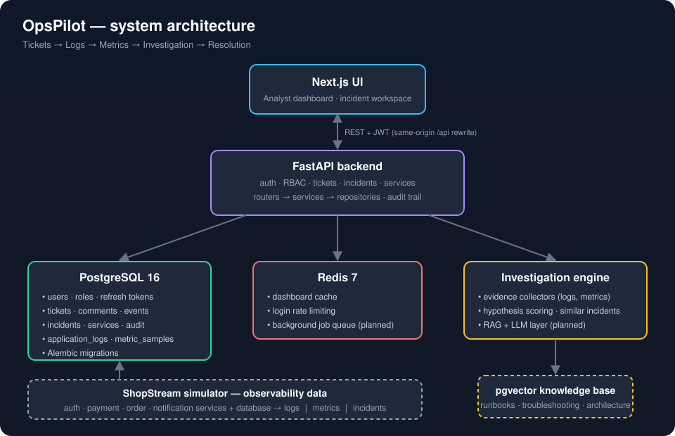
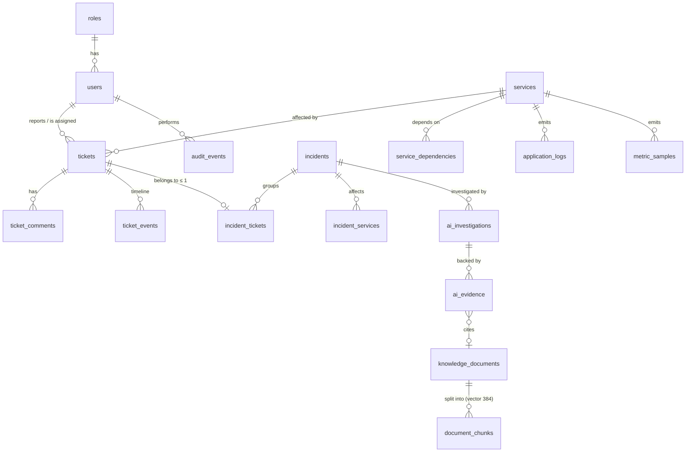

<div align="center">

# OpsPilot

### AI-Powered Application Support & Incident Intelligence

**Tickets → Logs → Metrics → AI Investigation → Resolution**

[Architecture](docs/architecture/README.md) · [Problem Statement](docs/problem-statement.md) · [API Docs](#api) · [Roadmap](#roadmap)

`FastAPI` · `Next.js` · `PostgreSQL` · `Redis` · `pgvector` · `Docker` · `GitHub Actions`

</div>

---

OpsPilot is an application support platform that correlates **support tickets**, **application logs** and
**service metrics** to help support engineers investigate incidents. Instead of a chatbot, it behaves like a
colleague who has already read the logs: every conclusion it draws is backed by evidence you can click through.

> **Status:** early development — the project is being built in public, step by step.

## The problem

ShopStream, a fictional SaaS company, runs an e-commerce and payment platform. Customers report symptoms —
*"payment fails after pressing Confirm Order"*, *"the dashboard takes 30 seconds to load"*, *"HTTP 500 on password
reset"* — and an Application Support Engineer has to walk from the ticket to logs, database, metrics, runbooks
and past incidents before a root cause emerges.

OpsPilot automates that evidence-gathering path and puts the result on one screen: a probable root cause,
a confidence score, the evidence behind it, next investigation steps and the relevant documentation.

→ Full write-up: [docs/problem-statement.md](docs/problem-statement.md)

## Architecture



A Next.js analyst UI talks to a FastAPI backend. PostgreSQL is the system of record (tickets, incidents, logs,
metrics, audit) and will hold the `pgvector` knowledge base; Redis provides caching and rate limiting.
The investigation engine correlates logs, metrics and past incidents into an evidence-backed root-cause report.

→ Components, flows and design principles: [docs/architecture](docs/architecture/README.md) ·
decisions: [docs/decisions](docs/decisions)

## ShopStream simulator

OpsPilot needs real evidence to investigate, so the repository ships a deterministic simulator of the fictional
ShopStream platform — `auth-service`, `payment-service`, `order-service`, `notification-service` and
`postgres-primary` — that emits realistic logs and per-minute metrics and can inject incidents:

```
2026-10-22T14:31:42Z INFO  payment-service  Payment request initiated order_id=ORD-84931
2026-10-22T14:31:42Z INFO  payment-service  Calling payment gateway provider=stripe
2026-10-22T14:31:47Z ERROR payment-service  GatewayTimeoutException provider=stripe timeout=5000ms order_id=ORD-84931
2026-10-22T14:31:47Z WARN  order-service  Payment failed order_id=ORD-84931 retry=1
```

| Scenario | Symptom | Metric footprint |
|---|---|---|
| `payment_gateway_timeout` | Checkout freezes after clicking Pay | payment p95 latency ≈ 5.3 s (+412 %), error rate 17 %, DB normal |
| `db_pool_exhaustion` | Dashboard takes 30 s to load | DB connections 99/100, query p95 2.4 s, order-service p95 29 s |
| `smtp_auth_failure` | HTTP 500 on password reset | notification error rate 58 %, auth-service error rate 4.5 % |

→ [simulator/README.md](simulator/README.md)

## Ticket management

The platform is useful before any AI is involved. Tickets follow a support lifecycle enforced by a state machine
([`ticket_workflow.py`](backend/app/services/ticket_workflow.py)):

```
OPEN ──► TRIAGED ──► INVESTIGATING ──► RESOLVED ──► CLOSED
  │         ▲  │            ▲              │
  │         └──┘ (back)     └── reopen ────┘
  └──► CLOSED (duplicate / not a bug — resolution note required)
```

- Human-friendly numbers (`TCK-2026-00042`) from a Postgres sequence, priority P1–P4, affected service, labels.
- Assignment, public and internal comments, and an append-only **event timeline** (created, status changed,
  priority changed, assigned, commented) written in the same transaction as the change.
- Concurrent updates to one ticket are serialised with `SELECT … FOR UPDATE`.
- The API returns `allowed_transitions` with every ticket so the UI only offers valid actions.

| Method | Endpoint | Purpose |
|---|---|---|
| `GET` | `/api/v1/tickets?status=&priority=&service=&assignee_id=&unassigned=&q=&page=` | Filtered, paginated queue |
| `POST` | `/api/v1/tickets` | Create a ticket |
| `GET` / `PATCH` | `/api/v1/tickets/{number}` | Read / edit title, description, priority, service, labels |
| `POST` | `/api/v1/tickets/{number}/transition` | Move through the lifecycle |
| `POST` | `/api/v1/tickets/{number}/assign` | Assign / unassign |
| `GET` / `POST` | `/api/v1/tickets/{number}/comments` | Discussion |
| `GET` | `/api/v1/tickets/{number}/events` | Timeline |

Interactive OpenAPI docs: `http://localhost:8010/docs`.

## Database design

18 tables in PostgreSQL 16 + `pgvector`, managed by Alembic migrations:



- **Integrity in the schema, not only in code:** foreign keys with deliberate `ON DELETE` rules, unique constraints
  (one incident per ticket, one metric value per series/minute), `CHECK` constraints for every enumeration,
  `confidence BETWEEN 0 AND 1`, no self-dependencies.
- **Indexes for real queries:** composite queue index, partial index on WARN/ERROR logs, BRIN on log timestamps,
  GIN on document tags, HNSW (`vector_cosine_ops`) on chunk embeddings.
- **JSONB only where justified** — variable log attributes, event payloads, engine-owned evidence data.
- **Transactions + audit:** each use case commits the change, its timeline event and its `audit_events` row together.
- A test fails if ORM models and migrations drift (`alembic` autogenerate comparison).

→ Full design notes and the complete ER diagram: [docs/architecture/database.md](docs/architecture/database.md)

The demo seed (`python -m app.scripts.seed --reset`) loads 60 days of incident history, ~300 tickets, and the last
6 hours of simulated logs/metrics with three live incidents.

## Authentication & access control

| Endpoint | Behaviour |
|---|---|
| `POST /api/v1/auth/login` | bcrypt-verified credentials → 15-minute **JWT access token** (HS256, algorithm pinned, issuer checked) in the body + **refresh token** in an `HttpOnly`, `SameSite=Strict` cookie scoped to `/api/v1/auth` |
| `POST /api/v1/auth/refresh` | **Rotates** the refresh token on every use. Presenting an already-rotated token is treated as theft: the whole token family is revoked |
| `POST /api/v1/auth/logout` | Revokes the session's refresh-token family and clears the cookie |
| `GET /api/v1/auth/me` | Current user, role and effective permissions |

Refresh tokens are opaque random strings stored only as SHA-256 hashes. Failed logins are throttled per
e-mail + IP in Redis (5 failures → 15-minute lock), error messages never reveal whether an e-mail exists, and login
timing is equalised for unknown users. Users are re-loaded on every request, so deactivating an account takes effect
immediately rather than when its JWT expires. Logins, failures, token-reuse detection and all user management
are written to `audit_events`.

**Role-based access control** — roles live in the database, permissions per role in
[`app/auth/permissions.py`](backend/app/auth/permissions.py), enforced with a `require(Permission.X)` dependency:

| Permission | Viewer | Support Agent | Engineer | Admin |
|---|:-:|:-:|:-:|:-:|
| `tickets:read`, `incidents:read`, `dashboard:read` | ✅ | ✅ | ✅ | ✅ |
| `tickets:write` — create/update/comment/assign | | ✅ | ✅ | ✅ |
| `incidents:investigate` — run investigations, link tickets | | | ✅ | ✅ |
| `users:manage` — `POST/PATCH/DELETE /users` | | | | ✅ |
| `services:manage`, `audit:read` | | | | ✅ |

`DELETE /api/v1/users/{id}` requires **admin**; it is a soft delete (history keeps its references) that also
revokes every refresh token. Admins cannot delete, deactivate or demote themselves.

Demo accounts (password `opspilot-demo`): `nikos@opspilot.dev` (admin), `maria@opspilot.dev` and
`alex@opspilot.dev` (engineer), `sam@opspilot.dev` (support agent), `viewer@opspilot.dev` (viewer).

## Repository structure

```
opspilot/
├── frontend/            Next.js analyst UI (app/, components/, hooks/, services/, tests/)
├── backend/
│   ├── app/
│   │   ├── api/         FastAPI routers
│   │   ├── auth/        JWT + role-based access control
│   │   ├── models/      SQLAlchemy ORM models
│   │   ├── schemas/     Pydantic request/response contracts
│   │   ├── services/    business rules, one transaction per use case
│   │   ├── repositories/ database access
│   │   ├── ai/          investigation engine
│   │   ├── workers/     background jobs
│   │   └── core/        config, database, security
│   └── tests/
├── simulator/           ShopStream environment (log_generator/, metric_generator/, incidents/)
├── knowledge-base/      runbooks/, troubleshooting/, architecture/
├── infrastructure/      docker/ (Dockerfiles), terraform/ (planned)
├── docs/                architecture/, decisions/, screenshots/
├── .github/workflows/   CI: backend lint + tests, frontend typecheck + build, Docker build
├── docker-compose.yml
├── .env.example
├── CONTRIBUTING.md
└── LICENSE
```

## Getting started

```bash
docker compose up --build        # UI http://localhost:3010 · API http://localhost:8010/docs
```

Ports are deliberately non-default (Postgres 5438, Redis 6381, API 8010, UI 3010) so OpsPilot can run next to
other local stacks. Local development without Docker for the apps is described in [CONTRIBUTING.md](CONTRIBUTING.md).

## Roadmap

| # | Step | Status |
|---|------|--------|
| 1 | Product identity | ✅ |
| 2 | Problem definition | ✅ |
| 3 | Architecture design | ✅ |
| 4 | Repository structure | ✅ |
| 5 | Enterprise application simulator | ✅ |
| 6 | Ticket management system | ✅ |
| 7 | Database design | ✅ |
| 8 | Authentication & RBAC | ✅ |
| 9 | Analyst dashboard | ⏳ |
| 10 | Incident investigation page | ⏳ |

## License

[MIT](LICENSE)
