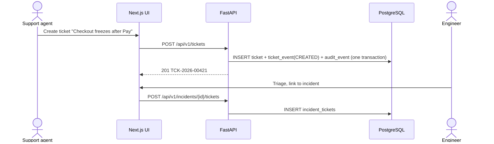
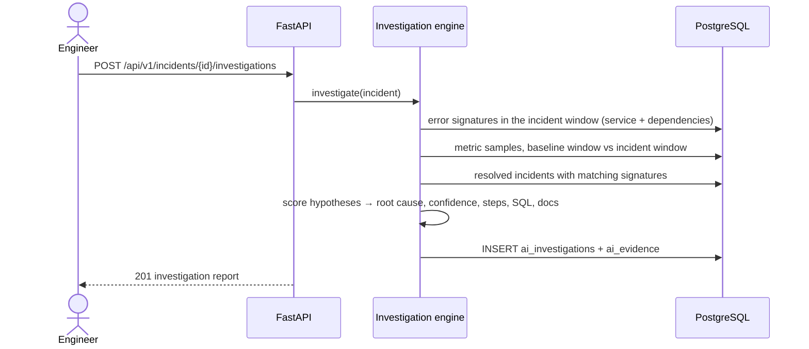

# Architecture


## Components

| Component | Technology | Responsibility |
|---|---|---|
| **Analyst UI** | Next.js (App Router), TypeScript, Tailwind CSS | Dashboard, ticket queue, incident workspace. Talks to the API through a same-origin `/api` rewrite so the refresh-token cookie stays first-party. |
| **Backend API** | FastAPI, SQLAlchemy 2, Pydantic 2 | Authentication, RBAC, ticket lifecycle, incident management, investigation orchestration, audit log. |
| **PostgreSQL** | PostgreSQL 16 + `pgvector` | System of record: users, tickets, incidents, services, logs, metrics, knowledge base, investigations, audit events. |
| **Redis** | Redis 7 | Short-lived state: dashboard cache, login rate limiting, and the background job queue (Redis Streams). |
| **Worker** | Python process | Runs AI triage and investigations off the request path (`python -m app.workers.main`). |
| **Investigation engine** | Python package `backend/app/ai` | Collects evidence (log signatures, metric deltas, dependency health, similar incidents), scores hypotheses, produces an evidence-backed report; retrieves runbook passages from pgvector (RAG), writes a cited summary (Claude or extractive) that must pass a grounding check, classifies tickets and proposes read-only SQL. |
| **Simulator** | Python package `simulator/` | Generates a realistic ShopStream environment — five services, logs and metrics, with injectable incident scenarios. |

## Backend layering

```
api/            HTTP routers — request parsing, status codes, dependency injection
  ↓
services/       business rules — ticket state machine, incident grouping, investigations
  ↓
repositories/   persistence — SQLAlchemy queries, no business rules
  ↓
models/         ORM mapping of the PostgreSQL schema
```

`schemas/` holds the Pydantic request/response contracts, `auth/` the JWT + RBAC dependencies and `core/` the
configuration, database session and security primitives. Routers never write through the ORM session directly;
they call a service, which wraps the unit of work in a single transaction.

## Main flows

### 1. Ticket → incident



### 2. Incident investigation



## Design principles

1. **Useful before AI.** Tickets, incidents and dashboards work without any model.
2. **Evidence first.** Every conclusion links to stored `ai_evidence` rows (log counts, metric deltas, documents, similar incidents).
3. **Least privilege.** Four roles, permission checks on every mutating endpoint, admin-only user management.
4. **Auditable.** State changes write an `audit_events` row in the same transaction.
5. **Reproducible.** `docker compose up` starts the full stack; the simulator generates deterministic data from a seed.

## Architecture decisions

See [`docs/decisions`](../decisions) for the ADRs.
