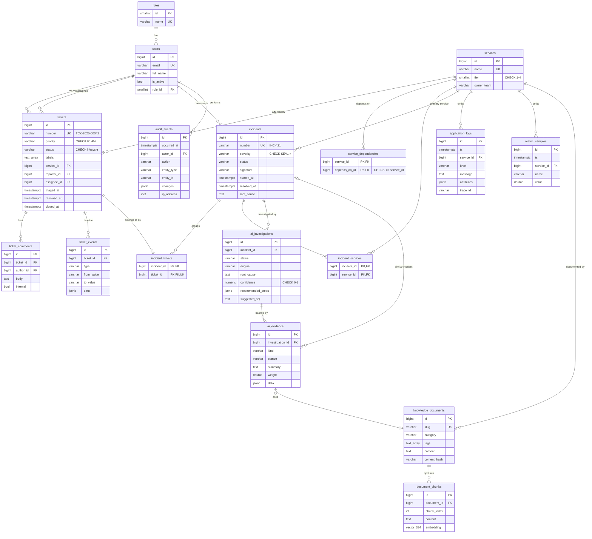

# Database design

PostgreSQL 16 with the `pgvector` extension. The schema is owned by Alembic migrations in
[`backend/migrations/versions`](../../backend/migrations/versions); a test (`test_models_match_migrations`) fails if the
ORM models and the migrations ever drift apart.

## Entity-relationship diagram

## Table groups

| Group | Tables | Notes |
|---|---|---|
| Identity | `roles`, `users` | Roles are reference data inserted by the migration (admin, engineer, support_agent, viewer). |
| Support | `tickets`, `ticket_comments`, `ticket_events` | `ticket_events` is an append-only timeline written with every change. |
| Incidents | `incidents`, `incident_tickets`, `incident_services` | Many tickets → one incident; one incident → many affected services. |
| Catalogue | `services`, `service_dependencies` | Dependency graph used to check upstream/downstream health during investigations. |
| Observability | `application_logs`, `metric_samples` | Samples of platform telemetry, produced by the simulator. |
| Knowledge | `knowledge_documents`, `document_chunks` | Runbooks and guides; chunks carry `vector(384)` embeddings for RAG. |
| AI | `ai_investigations`, `ai_evidence` | Every conclusion is stored with the evidence rows behind it. |
| Compliance | `audit_events` | Who did what to which entity; written in the same transaction as the change. |

## Integrity rules enforced by the database

| Rule | Mechanism |
|---|---|
| A ticket belongs to at most one incident | `UNIQUE (incident_tickets.ticket_id)` |
| A service cannot depend on itself | `CHECK (service_id <> depends_on_id)` |
| Ticket numbers / incident numbers / e-mails / service names are unique | unique constraints; numbers come from dedicated sequences (`ticket_number_seq`, `incident_number_seq`) |
| Enumerations (priority, status, severity, log level, evidence kind…) only hold known values | `VARCHAR` + `CHECK` constraints (easier to evolve than native `ENUM` types) |
| Confidence is a probability | `CHECK (confidence BETWEEN 0 AND 1)` |
| One metric value per series and minute | `UNIQUE (service_id, name, ts)` |
| No orphaned data | Foreign keys with explicit `ON DELETE` behaviour: `CASCADE` for owned children (comments, events, chunks, evidence), `SET NULL` for optional references (assignee, service), `RESTRICT` where history must be kept (ticket reporter, user role) |

## Indexes and why they exist

| Index | Query it serves |
|---|---|
| `tickets (status, priority, created_at DESC)` | The ticket queue: filter by status, order by priority and recency |
| `application_logs (service_id, ts DESC)` | "Logs of service X in the incident window" — the investigation engine's main query |
| `application_logs (service_id, ts) WHERE level IN ('WARN','ERROR')` | Partial index: error lookups stay small because errors are rare |
| `application_logs USING brin (ts)` | Append-only, time-ordered data: a tiny index for range scans and retention deletes |
| `application_logs (trace_id) WHERE trace_id IS NOT NULL` | Follow one request across services |
| `incidents (status, severity)`, `incidents (started_at)` | Dashboard counters and trend charts |
| `incidents (signature)` | Similar-incident lookup |
| `knowledge_documents USING gin (tags)` | Tag matching (`tags && ARRAY[...]`) |
| `document_chunks USING hnsw (embedding vector_cosine_ops)` | Approximate nearest-neighbour retrieval for RAG |
| `audit_events (entity_type, entity_id)`, `(actor_id, occurred_at DESC)` | "History of this ticket", "what did this user do" |

## Where JSONB is used — and where it is not

JSONB is used only where the structure genuinely varies or belongs to another component's version:

- `application_logs.attributes` — every log line has different fields (`order_id`, `provider`, `timeout`…).
- `ticket_events.data`, `audit_events.changes` — the payload depends on the event type.
- `ai_investigations.recommended_steps`, `ai_evidence.data` — shape is owned by the investigation engine version.

Everything that is filtered, joined or constrained (status, priority, service, timestamps, foreign keys) is a real column.

## Transactions

Service-layer methods are units of work: the domain change, its `ticket_events` timeline row and its `audit_events`
row commit together or not at all. Declaring an incident with linked tickets is a single transaction — if one ticket
is unknown or already linked elsewhere, nothing is written (`test_declare_is_atomic`). Concurrent changes to the same
ticket are serialised with `SELECT … FOR UPDATE`.
